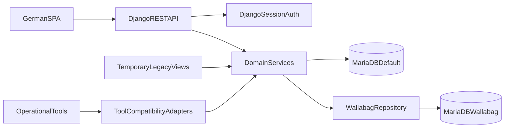

# Tipp-Game Modernization: Plan and Progress Tracker

## 1. Document control

| Field | Value |
|---|---|
| Product | Eisbären Berlin DEL Tipp-Game |
| Purpose | Requirements, architecture plan, delivery checklist, decisions, and progress tracking |
| Delivery model | Full SPA refresh with one coordinated big-bang cutover |
| Status | Planning complete; implementation not started |
| Target kickoff | Next working cycle |
| Product language | German |
| Last updated | 2026-08-04 |

### Status legend

- `Not started`: no implementation work begun
- `In progress`: actively being implemented
- `Blocked`: cannot continue without a decision or dependency
- `In review`: implementation complete and being verified
- `Done`: acceptance criteria met

---

## 2. Executive summary

The application is a mature Django Tipp-Game for the German Ice Hockey
League (DEL). It is dedicated exclusively to **Eisbären Berlin**, so each
matchday contains exactly **one relevant match**. The modernization will
replace the legacy server-rendered user interface with a modern German SPA
while retaining Python/Django, MariaDB, the existing business rules, and
compatibility with operational scripts in `app/tools/`.

Time to market is the primary delivery driver. The release may use a single
coordinated cutover, but implementation will still proceed through testable
milestones to control regression risk.

---

## 3. Confirmed decisions

| ID | Decision | Status | Source/rationale |
|---|---|---|---|
| DEC-001 | Continue using Python and Django for the backend | Confirmed | Product requirement |
| DEC-002 | Replace the legacy UI with a full JavaScript SPA | Confirmed | Product decision |
| DEC-003 | Keep MariaDB | Confirmed | Product requirement |
| DEC-004 | Keep the current database schema where practical | Confirmed | Tools and production compatibility |
| DEC-005 | Add a compatibility layer where modernization would otherwise break existing tools | Confirmed | Product requirement |
| DEC-006 | Use a coordinated big-bang production cutover | Confirmed | Time-to-market priority |
| DEC-007 | Design exclusively for Eisbären Berlin DEL matches | Confirmed | Product clarification |
| DEC-008 | Show exactly one relevant game per matchday | Confirmed | Product clarification |
| DEC-009 | Present the complete customer-facing UI in German | Confirmed | Product clarification |
| DEC-010 | Preserve existing scoring and tip semantics unless explicitly changed | Confirmed | Compatibility and regression safety |
| DEC-011 | Use React, TypeScript, and Vite for the SPA | Working default | Fast, mainstream SPA toolchain; validate at kickoff |
| DEC-012 | Use Django REST Framework for the API | Working default | Mature Django integration; validate at kickoff |
| DEC-013 | Keep Django session authentication and CSRF protection for the SPA | Working default | Minimizes auth migration risk |

### Decisions still requiring validation

| ID | Question | Current default | Required before |
|---|---|---|---|
| DV-001 | Does a user tip only the final score, or also the decision type (regulation/overtime/shootout)? | Preserve the current score-only model. `Tip.tip` is a single score string; the additional selector in the visual mockup is conceptual only. | Finalizing tip-entry API and UI |
| DV-002 | Which current screens and roles are still actively used? | Preserve all behavior until baseline review identifies obsolete flows. | Final scope freeze |
| DV-003 | Which production MariaDB version must be supported? | Match the deployed version; Compose currently uses MariaDB 11. | Integration test setup |
| DV-004 | Should SPA assets be served by Django or a separate web/CDN service? | Build into the existing deployable application artifact. | Deployment implementation |
| DV-005 | May Eisbären Berlin and DEL official visual assets be used? | Use provided/licensed assets only; otherwise use neutral placeholders. | Final visual design |

---

## 4. Product requirements

### 4.1 Functional requirements

- [ ] Users can register, activate an account, sign in, sign out, and manage
      their profile according to current rules.
- [ ] Users see the next or current Eisbären Berlin match as the primary
      matchday context.
- [ ] Exactly one match is presented for tip entry on a matchday.
- [ ] Users can create or update their score tip until the existing deadline.
- [ ] Tip locking, visibility, anti-cheat, group, and scoring rules remain
      behaviorally compatible with the current application.
- [ ] Users can see the match result and points awarded for their tip.
- [ ] Users can see the Tipp-Game participant ranking for the current season
      and selected matchday.
- [ ] Users can see their own rank, points, and relevant historical performance.
- [ ] Users can access Eisbären-related articles and the Presseschau.
- [ ] Existing notification, cron, data update, and operational tools continue
      to work.
- [ ] Existing administrative workflows remain available, either through the
      Django admin or an equivalent maintained interface.

### 4.2 UX and content requirements

- [ ] All customer-facing labels, messages, validation, dates, and times are
      German.
- [ ] Use German locale conventions (`de-DE`) and the application timezone.
- [ ] Use Eishockey terminology: `Spielbeginn` or `Bully`, never football
      terminology such as `Anstoß`.
- [ ] Focus every match card on Eisbären Berlin and one opponent.
- [ ] Do not show a multi-match fixture grid for a matchday.
- [ ] Make the current action obvious: `Jetzt tippen`, `Tipp ändern`, or
      `Tipp ansehen`.
- [ ] Clearly communicate the tip deadline and locked state.
- [ ] Ensure responsive behavior from mobile to desktop.
- [ ] Meet WCAG 2.2 AA as the accessibility target for core journeys.
- [ ] Support keyboard navigation, visible focus, semantic form labels,
      sufficient contrast, and understandable validation.
- [ ] Keep screens concise for a private/community Tipp-Game rather than
      presenting unnecessary enterprise dashboard metrics.

### 4.3 Non-functional requirements

- [ ] Continue to run on Python and Django.
- [ ] Continue to use MariaDB for both managed application data and configured
      external database integrations.
- [ ] Preserve data and backward compatibility during the cutover.
- [ ] Provide explicit API validation and consistent error responses.
- [ ] Protect session cookies, CSRF tokens, credentials, and personal data.
- [ ] Add useful structured logs and error reporting without exposing secrets.
- [ ] Keep build and deployment reproducible in CI and containers.
- [ ] Define measurable performance budgets for the SPA before release.

### 4.4 Out of scope for the first modernization release

- Replacing MariaDB with another database.
- A mobile-native iOS or Android application.
- A full redesign of the production schema.
- Rewriting operational tools in another language.
- Changing established scoring rules without a separate product decision.
- Supporting tipping for every DEL match; only Eisbären Berlin matches are in
  scope.

---

## 5. Current-state findings

### 5.1 Application structure

- Django project configuration: [`app/tipp_game/`](../app/tipp_game/)
- Main game app: [`app/game/`](../app/game/)
- Articles and Wallabag integration: [`app/article/`](../app/article/)
- Authentication: [`app/userauth/`](../app/userauth/)
- Messaging/integration app: [`app/trgw/`](../app/trgw/)
- Operational tools: [`app/tools/`](../app/tools/)
- Legacy templates: [`app/templates/`](../app/templates/) and app-local
  template directories
- Legacy static assets: [`app/static/`](../app/static/)
- Current CI: [`.github/workflows/ci.yml`](../.github/workflows/ci.yml)
- Container runtime: [`Dockerfile`](../Dockerfile) and
  [`docker-compose.yml`](../docker-compose.yml)

### 5.2 Key technical constraints

- Settings are centralized in
  [`app/tipp_game/settings.py`](../app/tipp_game/settings.py).
- The existing frontend is server-rendered Django with vendored JavaScript/CSS
  and no package-managed frontend build.
- Business logic is concentrated in large modules such as
  [`app/game/views.py`](../app/game/views.py) and
  [`app/game/myfunctions.py`](../app/game/myfunctions.py).
- Migration history is incomplete for major legacy apps.
- [`app/game/models.py`](../app/game/models.py) uses the third-party
  `jsonfield.JSONField` in several models.
- Wallabag tables are mapped as unmanaged models with fixed table names in
  [`app/article/models.py`](../app/article/models.py).
- The `default` and `wallabag` database aliases are relied on by application
  code and tools.
- Current CI runs `manage.py check` but does not run the full test suite.
- Some tests exist under [`app/tests/`](../app/tests/), but critical game
  behavior has little automated coverage.

### 5.3 Tools compatibility contract

The active scripts use Django models rather than raw SQL. Compatibility
therefore depends primarily on Python import paths, model fields, database
aliases, side effects, and data shape.

| Tool | Principal dependency | Compatibility expectation |
|---|---|---|
| `cron_create.py` | `Match`, `Season`, cron output | Preserve model contract and generated jobs |
| `notify_presseschau.py` | `Groupsetting`, Wallabag `Entries` | Preserve both database aliases and notification behavior |
| `update_presseschau.py` | `Feedlink`, `Feed` | Preserve update/idempotency behavior |
| `word_counter.py` | Wallabag `Entries`, `Articletopwords` | Preserve content decoding and database routing |
| `threema_chk.py` | `Threemacredit` | Preserve persistence behavior |

Known issue to address: `cron_create.py` derives a season identifier from a row
count. This assumption is unsafe when IDs are non-contiguous and should be
covered by a regression test before any correction.

---

## 6. Target architecture



### Architecture principles

1. API views handle transport and validation, not scoring rules.
2. Domain services contain reusable game, ranking, and article behavior.
3. Database repositories isolate external Wallabag schema assumptions.
4. Compatibility adapters preserve tool imports and invocation contracts.
5. The SPA consumes a documented, versioned `/api/v1/` contract.
6. Schema changes are additive unless a breaking change is explicitly approved.
7. Legacy routes remain available during parity verification and are removed or
   redirected only at cutover.

---

## 7. UX direction and reference screens

The approved visual direction is modern, clear, responsive, and German, using
dark blue, red, ice blue, and neutral tones. Exact club/league brand assets
require confirmation of usage rights.

### Screen 1: Startseite

- One prominent upcoming Eisbären Berlin game
- Opponent, venue, localized date/time, tip deadline, and status
- Primary action to submit or edit the tip
- Compact personal rank and scoring summary
- Last-game result and short ranking preview

Reference mockup: `tippgame-dashboard-del-de.png`

### Screen 2: Tippabgabe

- One game only
- Large, accessible home and away score controls
- Automatic save feedback where technically appropriate
- Explicit final-submit action and deadline
- Decision-type controls remain unconfirmed; see `DV-001`

Reference mockup: `tippgame-tippabgabe-del-de.png`

### Screen 3: Rangliste

- Participant ranking, not the official DEL club table
- Overall and matchday views
- Highlight the signed-in participant
- Show understandable scoring/performance data supported by existing rules

Reference mockup: `tippgame-rangliste-del-de.png`

### Screen 4: Nachrichten (mobile)

- Eisbären-focused Presseschau and articles
- Compact next-game/tip prompt
- Search, filters, and favorites only where supported or explicitly added
- Mobile bottom navigation

Reference mockup: `tippgame-nachrichten-del-de-mobile.png`

---

## 8. Delivery plan and progress checklist

### Progress overview

| Milestone | Status | Owner | Evidence/PR | Acceptance |
|---|---|---|---|---|
| M0 — Scope and baseline | Not started | TBD | — | Pending |
| M1 — Test safety net | Not started | TBD | — | Pending |
| M2 — API and service foundation | Not started | TBD | — | Pending |
| M3 — SPA foundation | Not started | TBD | — | Pending |
| M4 — Core game journeys | Not started | TBD | — | Pending |
| M5 — Articles and integrations | Not started | TBD | — | Pending |
| M6 — Tools and DB compatibility | Not started | TBD | — | Pending |
| M7 — CI, security, and observability | Not started | TBD | — | Pending |
| M8 — Release rehearsal | Not started | TBD | — | Pending |
| M9 — Production cutover | Not started | TBD | — | Pending |
| M10 — Post-release closeout | Not started | TBD | — | Pending |

### M0 — Scope and baseline

- [ ] Inventory all active routes, screens, user roles, scheduled jobs, and
      external integrations.
- [ ] Confirm which legacy features are actively used.
- [ ] Record current critical journeys:
  - [ ] Account registration and activation
  - [ ] Login, logout, password change/reset, and OTP where applicable
  - [ ] View next Eisbären game
  - [ ] Submit, change, lock, and reveal a tip
  - [ ] Enter/process a result and calculate points
  - [ ] View matchday and season participant rankings
  - [ ] View articles and Presseschau
  - [ ] Run each active operational tool
- [ ] Capture representative inputs and expected outputs as golden-master
      fixtures.
- [ ] Resolve `DV-001` through `DV-005`.
- [ ] Freeze first-release scope.

**Acceptance criteria**

- [ ] Product owner approves the active feature inventory.
- [ ] Golden-master scenarios cover every release-critical journey.
- [ ] First-release scope and deferred backlog are recorded.

### M1 — Test safety net

- [ ] Add characterization tests around current scoring and ranking behavior.
- [ ] Add authentication and authorization regression tests.
- [ ] Add tip deadline, hidden-tip, group, and anti-cheat regression tests.
- [ ] Add smoke tests for current article and Wallabag behavior.
- [ ] Add non-destructive smoke tests for each active tool.
- [ ] Make the existing test suite runnable consistently locally and in CI.

**Acceptance criteria**

- [ ] Every critical journey has at least one automated regression test or an
      explicitly documented manual release check.
- [ ] Current tests pass without requiring production services.
- [ ] Golden-master outputs are reproducible.

### M2 — API and service foundation

- [ ] Add Django REST Framework and `/api/v1/`.
- [ ] Define a consistent API error format.
- [ ] Publish an OpenAPI contract.
- [ ] Extract business logic from views and helper modules into services.
- [ ] Add repositories for multi-database and Wallabag access.
- [ ] Implement session authentication, CSRF bootstrap, current-user, and
      logout endpoints.
- [ ] Implement API permissions matching current authorization behavior.
- [ ] Keep legacy routes functional for parity testing.

**Acceptance criteria**

- [ ] API contract is documented and testable.
- [ ] Critical business rules are not duplicated in legacy and API paths.
- [ ] Legacy and API outputs match golden-master scenarios.

### M3 — SPA foundation

- [ ] Create a React + TypeScript + Vite frontend workspace.
- [ ] Add package lockfile and supported Node version.
- [ ] Implement API client, CSRF handling, session state, routing, and error
      boundaries.
- [ ] Establish German locale, date/time formatting, and terminology.
- [ ] Create accessible design tokens and reusable components.
- [ ] Implement responsive app shell and navigation.
- [ ] Define frontend unit/component and end-to-end test setup.
- [ ] Integrate the production build with the deployment artifact.

**Acceptance criteria**

- [ ] SPA builds reproducibly in CI.
- [ ] Authenticated and unauthenticated routing works securely.
- [ ] Shared components meet keyboard and contrast requirements.
- [ ] A production-like container serves the SPA and API correctly.

### M4 — Core game journeys

- [ ] Implement the Startseite with one upcoming/current Eisbären match.
- [ ] Implement score tip creation and editing.
- [ ] Implement locked, no-tip, saved, and completed-game states.
- [ ] Implement match result and awarded-points view.
- [ ] Implement participant season and matchday rankings.
- [ ] Implement personal history/performance using existing scoring data.
- [ ] Verify all labels and messages in German.
- [ ] Add component, API, and end-to-end tests.

**Acceptance criteria**

- [ ] A user can complete `login → view game → submit tip → view result and
      ranking` through the SPA.
- [ ] Exactly one game is displayed per matchday context.
- [ ] Tip deadlines and scoring results match legacy behavior.
- [ ] Core journey meets the agreed accessibility and responsive criteria.

### M5 — Articles and integrations

- [ ] Implement German article and Presseschau screens.
- [ ] Isolate Wallabag access behind the repository layer.
- [ ] Implement search, filters, and favorites only if confirmed as existing or
      explicitly approved scope.
- [ ] Preserve notification and messaging integration behavior.
- [ ] Verify graceful degradation when the Wallabag database is unavailable.

**Acceptance criteria**

- [ ] Existing article and Presseschau content is available through the SPA.
- [ ] External schema failures are logged and presented safely.
- [ ] Integration results match baseline scenarios.

### M6 — Tools and database compatibility

- [ ] Document required tables, fields, aliases, and model imports.
- [ ] Add database contract checks for `default` and `wallabag`.
- [ ] Keep unmanaged Wallabag models isolated and `managed = False`.
- [ ] Preserve current table and column names needed by operational tools.
- [ ] Route tools through stable adapters/services where useful without
      breaking their CLI contracts.
- [ ] Test tools against a realistic MariaDB snapshot.
- [ ] Test backup and restore with the target MariaDB version.
- [ ] Avoid native JSON field migration in the first release unless required.
- [ ] Correct unsafe assumptions only with regression coverage.

**Acceptance criteria**

- [ ] Every active tool completes its expected non-destructive smoke scenario.
- [ ] No required legacy table, field, import path, or DB alias is broken.
- [ ] Backup/restore rehearsal produces a working application database.
- [ ] Database contract checks fail with actionable messages.

### M7 — CI, security, and observability

- [ ] Run backend tests, frontend tests, SPA build, and Django checks in CI.
- [ ] Add MariaDB-backed integration tests for database-critical behavior.
- [ ] Add migration drift checks without generating unsafe legacy migrations.
- [ ] Add Python and frontend lint/format checks.
- [ ] Add dependency and security scanning.
- [ ] Review CSP, CSRF, cookies, HSTS, CORS, and trusted origins.
- [ ] Add structured logging and error reporting for APIs and jobs.
- [ ] Define health/readiness checks and release metrics.
- [ ] Define release-blocking quality gates.

**Acceptance criteria**

- [ ] CI enforces the agreed checks on every release change.
- [ ] No unresolved critical security findings remain.
- [ ] Authentication failures, API errors, and job failures are observable.

### M8 — Release rehearsal

- [ ] Restore a recent sanitized production-like backup in staging.
- [ ] Deploy the combined SPA/API release candidate.
- [ ] Run the full golden-master and UX checklist.
- [ ] Execute all tool smoke tests.
- [ ] Test supported desktop and mobile browsers.
- [ ] Validate accessibility and agreed performance budgets.
- [ ] Perform rollback rehearsal.
- [ ] Record all deviations and resolve release blockers.

**Acceptance criteria**

- [ ] No open release-blocking defects.
- [ ] Data, scoring, rankings, tools, and integrations pass rehearsal.
- [ ] Rollback steps are verified and documented.

### M9 — Production cutover

- [ ] Freeze unrelated production changes.
- [ ] Create and verify final database and media backups.
- [ ] Deploy backend API and SPA as one release.
- [ ] Run immediate health, auth, tip, ranking, article, and tool checks.
- [ ] Monitor errors, latency, job status, and user-reported issues.
- [ ] Roll back if a defined trigger is breached.

**Acceptance criteria**

- [ ] Critical user journeys pass in production.
- [ ] Scheduled and operational tools remain functional.
- [ ] No data integrity or scoring discrepancy is detected.

### M10 — Post-release closeout

- [ ] Resolve or prioritize non-critical release findings.
- [ ] Remove or redirect obsolete legacy customer-facing routes.
- [ ] Remove unused templates and vendored assets only after usage validation.
- [ ] Update operational and contributor documentation.
- [ ] Record architecture decisions and deferred technical debt.
- [ ] Establish ongoing dependency, test, and accessibility maintenance.

**Acceptance criteria**

- [ ] Modernized architecture is the documented supported path.
- [ ] Deferred work has an owner and priority.
- [ ] Release and rollback documentation reflects production reality.

---

## 9. Release acceptance checklist

### Product

- [ ] German content has been reviewed.
- [ ] Eisbären-only and single-game-per-matchday behavior is verified.
- [ ] Existing scoring behavior is unchanged or any change is explicitly signed
      off.
- [ ] Core desktop and mobile journeys match the approved UX direction.

### Data and compatibility

- [ ] MariaDB version compatibility is verified.
- [ ] Existing production data loads without destructive transformation.
- [ ] `default` and `wallabag` integrations pass.
- [ ] All active `app/tools/` scripts pass.
- [ ] Backup and restore are proven.

### Quality and operations

- [ ] Backend, frontend, integration, and end-to-end tests pass.
- [ ] Accessibility checks pass for critical journeys.
- [ ] Security review has no unresolved critical finding.
- [ ] Monitoring and alerts are active.
- [ ] Cutover and rollback runbooks are approved.

---

## 10. Implementation instructions

These rules apply throughout delivery:

1. Preserve observable behavior before refactoring it.
2. Add regression coverage before changing scoring, ranking, deadlines,
   authorization, database routing, or tool behavior.
3. Optimize for a single release, not a dual-frontend production period.
4. Prefer additive schema changes and stable compatibility adapters over
   renaming legacy database structures.
5. Never generate initial migrations against the production legacy schema
   without first reconciling and reviewing the actual schema.
6. Treat Wallabag as an external schema contract.
7. Keep transport logic, domain logic, and database integration separate.
8. Keep API contracts versioned and documented.
9. Do not add UI features merely because they appear in a mockup; validate
   them against product scope and current behavior.
10. Use German product copy and Eishockey terminology in all customer-facing
    UI.
11. Test every pull request in proportion to its risk and attach evidence to
    the progress table.
12. Keep rollback possible until production acceptance is complete.

---

## 11. Risk register

| ID | Risk | Impact | Mitigation | Status |
|---|---|---|---|---|
| R-001 | Hidden business rules in large legacy modules | Incorrect scoring or ranking | Characterization tests and incremental service extraction | Open |
| R-002 | Incomplete migration history | Destructive or divergent schema changes | Schema inventory; additive changes; no blind initial migration | Open |
| R-003 | Tool/model coupling | Broken scheduled or operational jobs | Contract inventory, adapters, realistic smoke tests | Open |
| R-004 | Wallabag schema drift or outage | Broken Presseschau | Repository isolation, schema checks, graceful failure | Open |
| R-005 | Big-bang regression blast radius | Broad production outage | Production-like rehearsal, golden masters, verified rollback | Open |
| R-006 | SPA auth/CSRF mistakes | Security or login failures | Django sessions, explicit CSRF flow, integration tests | Open |
| R-007 | Mockup introduces unsupported behavior | Scope expansion or scoring change | Product validation; preserve current semantics by default | Open |
| R-008 | Unlicensed brand assets | Legal/brand issue | Confirm rights or use neutral assets | Open |
| R-009 | Near-zero core test coverage | Undetected regressions | Front-load critical-path regression tests | Open |
| R-010 | Static source/build output collision | Deployment drift | Separate frontend source, build output, and collectstatic paths | Open |

---

## 12. Decision and change log

Add one row whenever scope, architecture, behavior, or release policy changes.

| Date | ID | Change/decision | Reason | Approved by |
|---|---|---|---|---|
| 2026-08-04 | DEC-001–006 | Full SPA, Django/Python, MariaDB, compatibility layer, big-bang cutover | Initial modernization discussion | Product |
| 2026-08-04 | DEC-007–009 | DEL, Eisbären Berlin only, one match per matchday, German UI | UX clarification | Product |
| 2026-08-04 | DEC-010 | Preserve current scoring semantics by default | Existing model stores score-only tips | Pending formal kickoff review |

---

## 13. Progress update template

Copy this section for each implementation update:

```text
Date:
Milestone:
Status:
Completed:
- 

In progress:
- 

Blocked/decisions needed:
- 

Verification evidence:
- Tests:
- Pull request:
- Screenshots:

Risks/changes:
- 

Next actions:
- 
```
